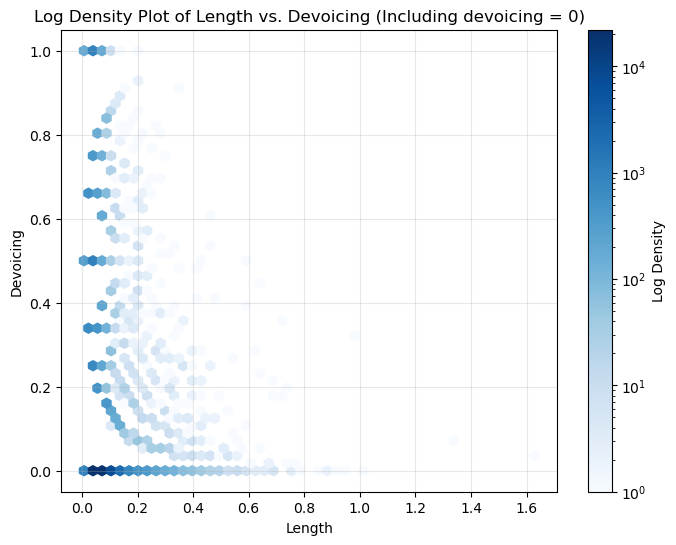
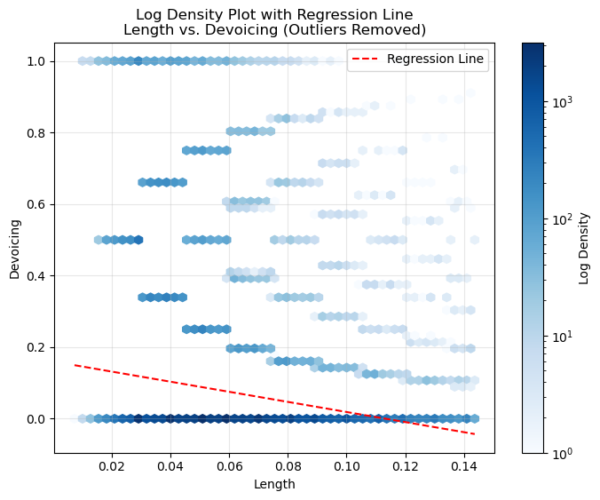
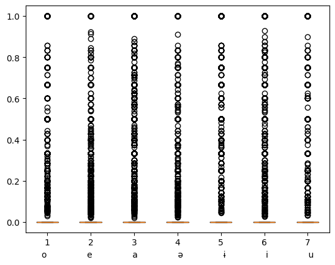
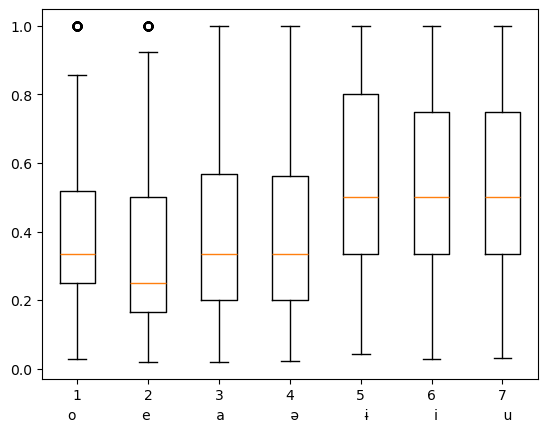
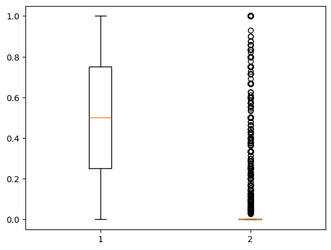

# 한국어 고모음 무성음화 양상 분석 - 서울 코퍼스와 Praat를 활용하여

2024학년도 2학기 언어데이터과학 기말 과제

## 1. 서론

### 1.1. 연구 목적

이 프로젝트의 목적은 The Korean Corpus of Spontaneous Speech(이하 서울 코퍼스)와 Praat를 활용하여 현대 한국어 서울 방언에서 일어나는 모음 무성음화를 유형론적으로 분석하고, 이러한 변동이 어떤 음성적-음운론적 환경에 기인하는지 확인하는 것이다. 

### 1.2. 연구 계획 대비 목표 달성 결과

|             | 계획                                                                                                                                                                                                                                | 실행                                                                                                     | 결과    |
| ----------- | --------------------------------------------------------------------------------------------------------------------------------------------------------------------------------------------------------------------------------- | ------------------------------------------------------------------------------------------------------ | ----- |
| 데이터 수집      | 서울 코퍼스의 TextGrid 레이블링 데이터 다운로드                                                                                                                                                                                                    | 서울 코퍼스를 다운로드함.                                                                                         | 전체 달성 |
| 데이터 가공      | `.wav + .TextGrid` 파일 -> 각 단모음 주변 음소 환경, 모음구간 길이와 FLUF를 담고 있는 데이터프레임 및 `.csv`                                                                                                                                                     | pandas 및 Praat Script를 사용하여 실행함. [[Python 코드](codes/TextGrid2String.ipynb)][[Praat Script](codes/devoicing.praat)] | 일부 달성 |
| 데이터 활용 및 분석 | matplotlib 라이브러리를 통해 데이터를 시각화하고 scipy 라이브러리를 활용하여 그 경향성을 통계적으로 검정할 수 있다. 본고에서는 다음과 같은 가설을 검토하였다. (1) 모음 길이가 짧을수록 무성음화되기 쉽다. (2) 고모음은 여타 모음에 비해 더욱 잘 무성음화된다. (3) 기존 연구의 재검토: [+spr, +cont]_[+spr, -cont] 환경에서는 무성모음화가 더 우세하게 일어난다. | [[코드](codes/data_analysis.ipynb)] 참조.                                         | 전체 달성 |

#### 1.2.1. 미달성 사유

초기 연구 계획에서는 서울 코퍼스에 기록된 단모음 전체를 대상으로 분석하려 했으나 이를 수집하기 위한 Praat Script의 실행 속도가 기대에 미치지 못하였다. 그럼에도 충분한 데이터(65413개의 모음 환경)가 가공되었으며 화자의 연령이 10대 후반으로 통제되었다는 점을 고려하여 데이터 가공을 중단하고 분석을 진행하였다.

## 2. 연구 방법

### 2.1. 코퍼스

서울 코퍼스는 10~40대 연령에 속한 40명의 서울 방언 화자가 다양한 주제에 대한 질문에 즉흥적으로 응답한 것을 녹음한 자연발화 코퍼스이다. 본 연구에서는 자원의 한계로 10대 후반 화자 10명의 발화로 자료를 한정하였다.

### 2.2. 데이터 가공

서울 코퍼스의 TextGrid로부터 모음이 위치한 구간을 Python으로 추출하고 주변 음소 환경을 기록하였다. 여기에 더해 각 구간의 Fraction of Locally Unvoiced Frames(FLUF)를 Praat script로 계산하여 모음구간, 음소 환경 정보와 병합하고 데이터프레임화하였다.

## 3. 연구 결과

### 3.1. 현상 기술 및 분석

#### 3.1.1. 모음 길이와 무성음화의 연관성

주어진 자료의 모음 길이와 devoicing rate로 scatter plot을 그리면 아래와 같다. 점 밀도에 따라 log-scale로 채색하였다.

log-scale임에도 불구하고 devoicing rate가 0인 구간에 매우 짙게 표시된 것을 확인할 수 있는데, 이는 대부분의 환경에서 완전한 유성음으로 실현되는 모음의 특성 때문이다. Devoicing rate 0.5를 기준으로 대칭인 형태를 보이는 이유는 Praat의 FLUF가 단위시간 프레임 당 무성음화된 프레임 수를 계산하여 유리수에 근사한 값을 반환하기 때문이다. 즉 모음구간이 짧을수록 분모에 해당하는 프레임 수가 적게 되면서 devoicing rate가 양자화된다. 이는 Praat을 사용한 무성음화 척도 계산의 한계라 할 수 있다. 

모음 길이를 기준으로 이상치를 제거하고 회귀 직선을 그려 보면 이 두 가지 경향이 더욱 두드러지게 관찰된다.

한편 모음 길이와 devoicing rate 사이에는 피어슨 상관계수 -0.11로 약한 음의 상관관계가 있는 것으로 관찰되며, p-value 4.10e-179로 이러한 관계는 통계적으로 유의미하다.

#### 3.1.2. 고모음의 무성음화 경향성

각 모음별 무성음화 비율을 boxplot으로 나타내면 아래와 같이 알아보기 어렵게 된다.

이 역시 대부분의 환경에서 완전한 유성음으로 실현되는 모음의 특성 때문이다. 설명력을 일부 포기하고 devoicing rate가 0을 초과하는 데이터에 한정하여 boxplot을 다시 그려보면 아래와 같이 뚜렷한 경향성을 관찰할 수 있다. 이로부터 고모음이 중모음과 저모음보다 잘 무성음화된다고 추측해볼 수 있다.

devoicing rate > 0 으로 한정하지 않아도 독립표본 t-검정을 통해 이러한 추정이 참임을 확인해볼 수 있다. 고모음 /i/, /ɨ/, /u/ 의 devoicing rate 평균은 11.88%, 중모음과 저모음은 4.29%이고 T-통계량 35.34, p-value 4.72e-271로 고모음에서의 무성음화 비율이 타 환경에 비해 유의미하게 높았다.

#### 3.1.3. [+spread glottis, +continuant]_[+spread_glottis, -continuant]의 고모음 무성모음화

초기 연구의 재검토를 위해 [+spread glottis, +continuant]_[+spread_glottis, -continuant] 환경에서의 고모음 무성모음화 양상을 파악하였다. 이 환경에 해당하는 고모음의 devoicing rate 평균은 52%에 달했고 그 외 환경의 고모음 devoicing rate 평균은 9%에 그쳤다. T-통계량 23.07, p-value 4.74e-74로 해당 환경에서의 무성음화 비율이 통계적으로 유의미하게 높았다.

## 4. 결론

본고에서는 다음의 세 가지 가설을 검토하고자 했다.

1. 모음 길이가 짧을수록 무성음화되기 쉽다. 

2. 고모음은 여타 모음에 비해 더욱 잘 무성음화된다.

3. [+spr, +cont]_[+spr, -cont] 환경에서는 무성모음화가 더 우세하게 일어난다.

<<<<<<< Updated upstream
1번 가설에 대해서 시각화와 상관계수 검정을 통해서 약한 상관관계가 있음을 추정, 검증할 수 있었으나 Praat의 FLUF 양자화 문제를 피하지 못하였다. 본 가설은 추후 스펙트로그램을 바탕으로 한 무성음화 분석 방법을 대안으로 삼아 다시 분석해볼 필요가 있다고 생각된다. 2번과 3번 가설은 분석 결과 참이었다.
=======
1번 가설에 대해서 시각화와 상관계수 검정을 통해서 약한 상관관계가 있음을 추정, 검증할 수 있었으나 Praat의 FLUF 양자화 문제를 피하지 못하였다. 본 가설은 추후 스펙트로그램을 바탕으로 한 무성음화 분석 방법을 대안으로 삼아 다시 분석해볼 필요가 있다고 생각된다. 2번과 3번 가설은 분석 결과 참이었다.
>>>>>>> Stashed changes
